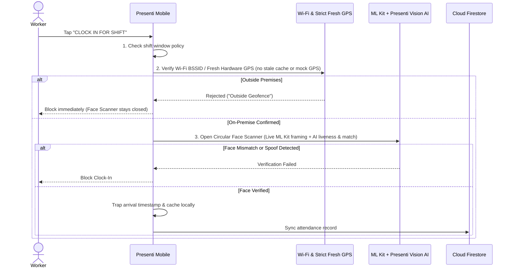

# Presenti — Mobile Workforce & Presence Verification App

[](https://expo.dev/)
[](https://reactnative.dev/)
[](https://www.typescriptlang.org/)
[](https://firebase.google.com/)
[](https://developers.google.com/identity)

**Presenti Mobile** is the workforce and field-admin client for the Presenti attendance and physical presence verification platform. It combines **pre-scan Wi-Fi BSSID & anti-spoof GPS verification**, **real-time ML Kit + AI facial biometrics**, **native hardware device biometrics**, and **Presenti AI** workforce intelligence inside a **high-contrast ArtCraft UI** tuned for 60fps fluidity on both flagship and budget smartphones.

---

## Core Capabilities & Recent Updates

### 1. AI Face Scan & Live Verification (`FaceScannerModal.tsx`)
- **Mandatory Onboarding Face Registration (`onboarding.tsx`):** Every new worker must capture and validate their official biometric reference photo during account creation (`CAPTURE & ENROLL FACE`), with a **Preview & Confirm** step (**USE THIS PHOTO** / **RETAKE PHOTO**) before completing setup.
- **Persistent Onboarding Drafts:** Paired organization code, form fields, and captured face photo are saved per user in `AsyncStorage` (`@presenti_onboarding_draft_<uid>`), so minimizing or closing the app resumes right where the user left off.
- **Instant Live Framing Feedback (On-Device ML Kit):** Runs `RNMLKitFaceDetector` continuously (~850ms) in the background—no waiting to tap Scan—delivering immediate guidance (*"No face detected"*, *"Multiple faces in frame"*, *"Move closer"*, *"Move slightly back"*, *"Face not well fitted"*, *"Look straight ahead"*, *"Keep your eyes open"*), turning the ring green when aligned.
- **AI Lighting, Anti-Spoofing & 1-to-1 Matching (`aiFaceVerificationService.ts`):** Validates lighting quality, blocks screen/paper photo spoofs, and compares live clock-in selfies against the worker's enrolled reference photo (`facePhotoURL`).
- **Firestore Payload Safety:** Automatically compresses face photos and uploads to Firebase Storage (or stores compact inline data URIs under 600KB safely within Firestore's 1MB document limit).

### 2. Ask Presenti AI & Cross-Device Chat Sync (`AskPresentiChatModal.tsx`)
- **Conversational Workforce Intelligence (`geminiService.ts`):** Floating chat assistant inside the Admin Hub answering live queries on registered headcount, late arrivals, department turnout, missing staff, and general leadership questions with clean markdown formatting (`**bold**`, `*bold*`, headings, dividers, and bullets).
- **1-Click Executive Briefing:** Generates WhatsApp/Email-ready daily summaries with one-tap **COPY**.
- **0ms Local Telemetry Fallback:** Instant offline/slow-network answers for greetings, identity, registered worker counts, late arrivals, department turnout, and unpunched staff.
- **Cross-Device Sync (`aiChatHistoryService.ts`):** Syncs conversations in real time via Firestore (`churches/{orgId}/ai_chats/{userId}`) with the Admin Web Portal, including instant local clear + background cloud deletion.

### 3. Pre-Scan Physical Presence & Anti-Spoof GPS (`locationService.ts`, `presenceVerificationService.ts`)
- **Location Verified *Before* Face Scan (`index.tsx`):** Both **Clock In** and **Clock Out** verify physical presence (Wi-Fi BSSID / GPS Geofence) *before* opening the Face Scanner, blocking out-of-perimeter attempts immediately.
- **Strict Fresh Hardware GPS (`strictFresh: true`):** Attendance punches never fall back to `getLastKnownPositionAsync()`, reject stale OS-cached fixes (>90s) by forcing a live `BestForNavigation` / `watchPositionAsync` reading, and block Android Mock/Fake GPS apps (`mocked === true`).
- **Dual Verification Modes:**
  - **Satellite GPS Geofence (`GEOFENCE_ONLY`):** Router-free perimeter checks (10m–100m radius).
  - **Hybrid Office Router (`HYBRID`):** Ambient hardware Wi-Fi MAC (`BSSID`) scan with automatic GPS perimeter failover.

### 4. ArtCraft UI & Budget-Phone Performance (`premium.ts`, `TactilePressable.tsx`)
- **ArtCraft Design System (`#f2f1ee` paper canvas, `#ffffff` floating cards, `#142748` navy ink, `#2d81ff` electric blue accent):** Consistent `18px` rounded cards, soft elevation, `56px` rounded primary CTAs, pill status badges, and vivid coloured high-contrast toasts (`ToastContext.tsx`).
- **60fps Fluidity Optimizations:**
  - Isolated 1-second `LiveClockDisplay` (`React.memo`) so `DashboardScreen` never re-renders every second.
  - Native-driver `TactilePressable` spring animations + Android ripple feedback running on the UI thread.
  - `GestureHandlerRootView`, native `slide_from_right` stack transitions, and Android `LayoutAnimation` in `_layout.tsx` and `AdminHub.tsx`.

### 5. Mobile Leadership Command Center & Full Web Parity (`AdminHub.tsx`, `admin-onboarding.tsx`)
- **Full Mobile Admin Onboarding (`admin-onboarding.tsx`):** Field administrators can create and configure their entire organization directly on mobile (organization identity, verification architecture, GPS/Wi-Fi calibration, departments, and unified/per-day shift schedules) with automatic draft persistence.
- **5-Tab Swipeable Admin Hub (`Feed`, `Anchors`, `Staff`, `Audits`, `Manage`):**
  - **Feed:** Real-time attendance stream, KPI cards, department filters, and punch audit modals.
  - **Anchors:** Smooth animated `AccordionCard` sections for Verification Architecture, GPS Coordinates, Perimeter Radius, Office Wi-Fi BSSID, and a dedicated **Full-Screen Map Adjustment Modal** (`PresenceMapMobile`) that prevents horizontal tab-swipe conflicts while zooming or dragging pins.
  - **Staff:** Member directory, face/device binding resets, status toggles, and a **2-Step 5-Minute Admin Test AI Face Scanner** (enroll temporary test face → verify authenticity with automatic local-storage expiry after 5 minutes).
  - **Audits (`AdminAuditsTab.tsx`):** Historical attendance logs, daily compliance summaries, and CSV/report export.
  - **Manage (`AdminManageTab.tsx`):** Organization details, department management, and unified/per-day shift policy configuration.
- **Draggable AskPresenti AI Bubble:** Floating chat trigger can be freely dragged anywhere on screen via `PanResponder` so it never obstructs bottom tabs.
- **1-Worker-1-Phone Hardware Binding (`deviceService.ts`):** Deterministic hardware fingerprint binding blocks proxy clock-ins across devices.

### 6. Native Biometric Fallback, Policy Engine & Offline Queue
- Hardware-isolated fallback via `expo-local-authentication` (`AndroidX BiometricPrompt` & iOS `LocalAuthentication`) with deep-linking to device Security Settings.
- Dynamic `UNIFIED` and `PER_DAY` shift schedules (`evaluateAttendanceWindow`), late tagging (`LATE`), biometric sign-out, sub-second timestamp trapping, and `AsyncStorage` offline queue flushing.

---

## System Architecture



---

## Tech Stack

| Component | Technology |
|---|---|
| **Framework** | React Native `0.86` (Expo SDK `57`, Expo Router) |
| **Language** | TypeScript `6.0` |
| **Design Tokens & Motion** | ArtCraft design tokens (`src/constants/premium.ts`), `TactilePressable`, `react-native-gesture-handler`, `LayoutAnimation` |
| **On-Device & Cloud Face AI** | `@infinitered/react-native-mlkit-face-detection` + Groq Vision (`qwen/qwen3.8-27b`) with Gemini Vision fallback (`gemini-3.5-flash-lite` → `gemini-3.8-flash`) |
| **Workforce AI Assistant** | Gemini API (`AskPresentiChatModal`) + Firestore cross-device chat sync |
| **Biometric Fallback** | `expo-local-authentication` (Android BiometricPrompt & iOS LocalAuthentication) |
| **Authentication** | Google Sign-In Native SDK (`@react-native-google-signin/google-signin`), Email/Password & OTP + Firebase Auth |
| **Database & Storage** | Firebase Firestore v13 + Firebase Storage |
| **Wi-Fi & Location** | `react-native-wifi-reborn` + `expo-location` (strict fresh GNSS & anti-mock) |
| **Camera** | `expo-camera` (`CameraView`) |
| **Local Storage** | `@react-native-async-storage/async-storage` |

---

## Getting Started

### Prerequisites
- Node.js 18.x or 20.x
- Expo CLI (`npx expo`)
- EAS CLI (`npx eas-cli@latest`)
- Android Device (for native development or preview APK)

### Installation

1. Clone and install dependencies:
   ```bash
   git clone https://github.com/kachiDeGreat/Presenti-mobile.git
   cd Presenti-mobile
   npm install
   ```

2. Configure `.env` in `MOBILE-APP/`:
   ```env
   EXPO_PUBLIC_FIREBASE_API_KEY=your_firebase_api_key
   EXPO_PUBLIC_FIREBASE_AUTH_DOMAIN=your_project.firebaseapp.com
   EXPO_PUBLIC_FIREBASE_PROJECT_ID=your_project_id
   EXPO_PUBLIC_FIREBASE_STORAGE_BUCKET=your_project.appspot.com
   EXPO_PUBLIC_FIREBASE_MESSAGING_SENDER_ID=your_sender_id
   EXPO_PUBLIC_FIREBASE_APP_ID=your_app_id
   EXPO_PUBLIC_GOOGLE_WEB_CLIENT_ID=your_google_web_client_id.apps.googleusercontent.com
   EXPO_PUBLIC_GEMINI_API_KEY=your_gemini_api_key
   EXPO_PUBLIC_GROQ_API_KEY=your_groq_api_key
   ```

3. Ensure `google-services.json` is present in `MOBILE-APP/` for Android builds.

---

## Project Architecture (`MOBILE-APP/src/`)

```text
MOBILE-APP/src/
├── app/            # Expo Router screens (index, login, onboarding, admin-onboarding, calibrate)
├── components/     # Reusable UI & modals (AdminHub, AccordionCard, LocationPickerModal, FaceScannerModal, AskPresentiChatModal, PresenceMapMobile)
├── config/         # Firebase client initialization (firebase.ts)
├── constants/      # ArtCraft design tokens & width-responsive typography (premium.ts)
├── context/        # React Context providers (AuthContext, ToastContext)
├── data/           # Offline cascading Country/State/City-LGA datasets (locationsData.ts)
├── hooks/          # Custom React hooks
├── services/       # Cloud, AI, GPS, Wi-Fi, and device-binding services
├── types/          # Shared TypeScript interfaces
└── utils/          # Multi-shift & time-policy evaluation utilities (timePolicy.ts)
```

---

## TCC Hackathon 2026 — Pre-Sprint vs. Sprint Breakdown

### Pre-Sprint Foundation (Existing Before Nov 22, 2026)
- Firebase Auth (Google SSO, Email/Password + OTP) and Cloud Firestore workspace sync.
- 1-Worker-1-Phone hardware binding (`deviceService.ts`) and pre-scan Wi-Fi BSSID / strict fresh GPS geofencing.
- Initial Face Scanner (`FaceScannerModal.tsx`), AskPresenti AI chat, and Mobile Admin Hub.

### Sprint Features Built During Nov 22–24, 2026
- **Multi-Shift Support (`MULTI_SHIFT`):** Morning (`06:00–14:00`), Afternoon (`14:00–22:00`), and overnight-aware Night (`22:00–06:00`) shift configuration in Admin Onboarding & Manage Tab, worker shift selection during onboarding, and shift-aware `evaluateAttendanceWindow` policy evaluation.
- **Cascading Location Dropdowns (`locationsData.ts`, `LocationPickerModal.tsx`):** Offline searchable Country (including `Other ▾`) → States A–Z (all 36 Nigerian states + FCT) → Cities / LGAs (including Cross River LGAs) in Admin Onboarding.
- **Width-Responsive Typography & Accessibility Scaling (`rf()` + `maxFontSizeMultiplier`):** Consistent sizing across budget & flagship screens even with large OS font zoom.

### Building & Running

```bash
# TypeScript check
npx tsc --noEmit

# Start Metro dev server (for Development Client)
npm start

# Build Development Client APK
npm run build:dev -- --no-wait

# Build Standalone Preview APK
npm run build:preview -- --no-wait
```

> **Note:** Uninstall any older Presenti APK before switching between Development and Preview builds on Android.

---

## Related Repositories

- **Admin Web Portal (React / Vite):** [kachiDeGreat/Presenti-web-admin](https://github.com/kachiDeGreat/Presenti-web-admin)
- **Live Admin Web Portal:** [https://presenti-admin-web.vercel.app](https://presenti-admin-web.vercel.app)

---

## AI Disclosure

- **Biometric Face Liveness & 1-to-1 Matching:** Uses on-device Google ML Kit (`RNMLKitFaceDetector`) for real-time framing, **Groq Vision (`qwen/qwen3.8-27b`)** as the primary cloud verifier, and **Google Gemini Vision (`gemini-3.5-flash-lite` / `gemini-3.8-flash`)** as an automatic fallback when Groq is rate-limited or unavailable.
- **AskPresenti Workforce Assistant:** Uses **Google Gemini** (`geminiService.ts`) combined with live Firestore organization telemetry and a local offline fallback for instant operational answers.
- **Development Assistance:** AI coding assistance was used during this sprint for refactoring, UI/UX implementation, performance tuning, and documentation.

---

## License

Private & Proprietary — Developed for Presenti Workforce Systems.
