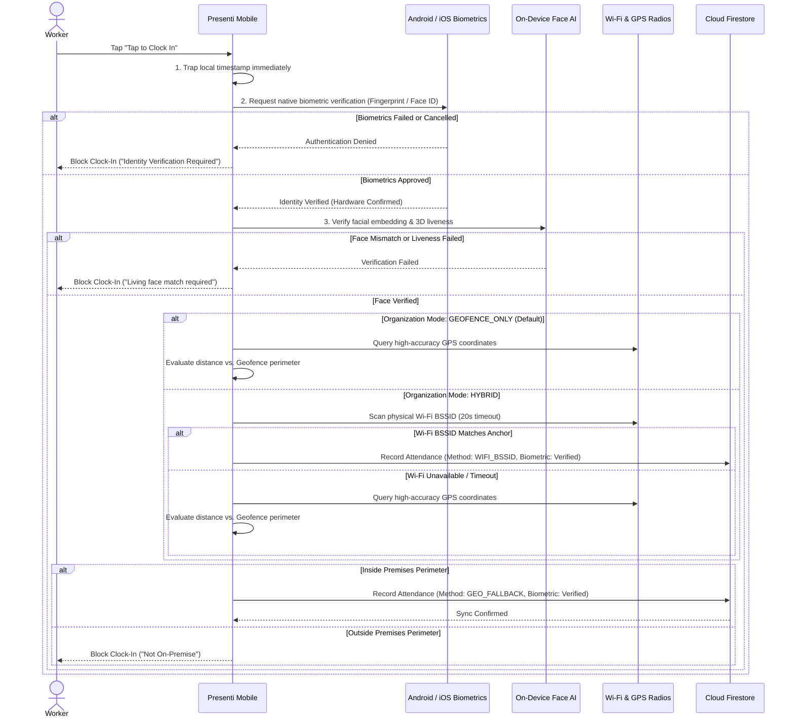

# Presenti — Mobile Workforce & Presence Verification App

[](https://expo.dev/)
[](https://reactnative.dev/)
[](https://www.typescriptlang.org/)
[](https://firebase.google.com/)
[](https://developers.google.com/identity)

**Presenti Mobile** is the client application for the Presenti workforce attendance and presence verification platform. Designed for modern workforces, institutions, and organizations, it guarantees verified physical presence using hardware radio scanning, satellite GPS geofencing, on-device facial recognition AI, native biometrics, and single-device cryptographic locks—eliminating proxy attendance, location spoofing, and buddy punching.

---

## Core Capabilities & Features

### 1. Dual-Tier Biometric Security & On-Device Face AI
- **Native OS Biometrics:** Mandatory hardware-isolated scans via `expo-local-authentication` (`AndroidX BiometricPrompt` & iOS `LocalAuthentication`) with `disableDeviceFallback: true`.
- **On-Device Facial Biometrics & Liveness Verification:**
  - Extracts 128-dimensional biometric embeddings using Google ML Kit landmarks.
  - Multi-frame 3D liveness and anti-spoofing engine detects natural physiological variance (micro-saccades, breathing expansion) to block printed 2D photos, tablet screen replays, and photo proxies.
  - Smooth Apple Face ID-inspired circular reticle overlay with real-time feedback.
  - Payload safety: Compresses face photos and routes storage to Firebase Storage or micro-thumbnails (<70KB), strictly preventing Firestore document size limit exceptions.
- **Graceful Fallback & Settings Deep Link:** Automatic fallback to device lockscreen credentials on budget devices without biometric sensors. One-tap "Go to Settings" deep links directly to system biometrics enrollment.

### 2. Instant Clock-In Timestamp Trapping
- **Zero-Latency Trapping:** Traps the exact sub-second timestamp the millisecond the worker taps **"Tap to Clock In"**.
- **Tamper-Resistant Clock:** Trapped arrival timestamps are stored in memory before background network or presence verification starts. Workers are never penalized for cellular latency or brief network drops.

### 3. Smart Policy Enforcement, Late Tagging & Biometric Sign-Out
- **Dynamic Day-Specific vs. Unified Schedules:**
  - Evaluates today's operating rules dynamically using `evaluateAttendanceWindow`.
  - When the organization uses **Different Times per Day (`PER_DAY`)**, the app automatically resolves today's specific day-of-week settings (`arrivalCutoff`, `lateTolerance`, `allowLateSignIn`, `enableSignOut`, and `signOutTime`).
  - Seamlessly falls back to unified default policy settings for backwards compatibility.
- **Window Open & Close Enforcement:** Displays real-time countdown to arrival window opening and closing.
- **Late Sign-In Tagging (`allowLateSignIn`):**
  - When late tolerance is enabled, arriving after the cutoff activates the amber **"Tap to Clock In (Late)"** action button.
  - Submitting stamps the record with an immutable **`LATE`** status tag displayed directly on the attendance card and synchronized to the admin dashboard.
  - If late tolerance is disabled, attendance strictly locks down once the window passes.
- **Biometric Departure Sign-Out (`enableSignOut`):**
  - Sign-out unlocks from the configured departure time (`signOutTime`, e.g., 05:00 PM) and remains available indefinitely until the next service day.
  - Protected with native biometrics to prevent proxy clock-outs.
- **Automatic Queue Flushing:**
  - Automatically caches punches locally in `AsyncStorage` and flushes all pending records to Cloud Firestore on app mount, foreground resume (`AppState === 'active'`), and manual pull-to-refresh.

### 4. Dual-Mode Physical Presence Engine
The mobile application dynamically reads the organization's calibrated architecture:
- **Mode 1: Router-Free Satellite GPS Geofence (Default & Recommended):**
  - Bypasses physical router scanning for modern offices, field teams, and pop-up events.
  - Verifies presence directly against high-accuracy satellite GPS coordinates with sub-second response times.
- **Mode 2: Hybrid Physical Office Router (Optional Dual-Tier):**
  - **Tier 1 — Hardware Wi-Fi Anchor (BSSID):** Scans the device's physical Wi-Fi radio for the organization's calibrated router MAC address (`targetBssid`).
  - **20-Second Hardware Scan Timeout:** If physical Wi-Fi scanning times out, the app automatically fails over to Tier 2 geofencing.
  - **Tier 2 — GPS Perimeter Geofencing:** Calculates distance from calibrated coordinates using high-accuracy native GPS (`expo-location`). Clock-in is approved only if within the calibrated perimeter (10m to 100m).

### 5. Role-Based Governance & Mobile Leadership Hub
- **Mobile Admin Hub (`AdminHub.tsx`):** Authorized administrators can toggle to the Admin Hub to:
  - Monitor the live workforce attendance feed in real time.
  - Inspect key performance indicators (Total Present, On-Time, Late, Attendance Rate).
  - Filter attendance records by department.
  - Calibrate presence anchors (GPS Geofence or Hybrid Wi-Fi) directly on their smartphone.
- **Hardware Device Binding:** Workers' accounts are permanently bound to their smartphone's unique hardware identifier, preventing multiple workers from clocking in from a single phone.

### 6. Administrator Premises Calibration Suite
- **Secret 5-Second Logo Gesture:** Calibration mode is completely invisible to regular workers. Administrators access it by pressing and holding the Presenti logo for 5 seconds.
- **QR Code Pairing Gateway:** Administrators scan a live session QR code displayed on the Admin Web Portal to pair their phone.
- **Multi-Tiered Geocoding Engine:** Global and local venue search powered by OpenStreetMap Nominatim, Photon (Komoot), and Google Play Services Geocoder.
- **Interactive Search Suggestions Dropdown:** Displays instant matching locations and landmarks below the search bar with one-tap pinning.
- **Smooth Satellite Map Fly-To:** Automatically glides the satellite view directly to the selected venue or coordinates.
- **Physical Spectrum Scanner:** Discovers nearby Wi-Fi access points, signal strength (RSSI), and exact router BSSID MAC addresses for binding.

### 7. Streamlined Worker Onboarding & Google Sign-In
- **Native Google SSO:** Single sign-on powered by `@react-native-google-signin/google-signin` on Android/iOS and Firebase Auth.
- **Automated Organization Code Formatting:** Auto-inserts hyphens as workers type their organization code (`XX-XXX-XXX`, e.g., `KW-RTX-482`).
- **Dynamic Department Enrollment:** Dynamically loads department listings from the organization's cloud profile.

---

## System Architecture



---

## Tech Stack

| Component | Technology |
|---|---|
| **Framework** | React Native (Expo SDK 52) |
| **Routing** | Expo Router (File-based navigation) |
| **Language** | TypeScript 5.6 |
| **Biometric Security** | `expo-local-authentication` (Android BiometricPrompt & iOS LocalAuthentication) |
| **Face Recognition AI** | Google ML Kit Landmarks + On-Device Vector Cosine Similarity & 3D Liveness |
| **Authentication** | Google Sign-In Native SDK (`@react-native-google-signin/google-signin`) + Firebase Auth |
| **Database** | Firebase Firestore (Real-time snapshots & offline cache) + Firebase Storage |
| **Wi-Fi Hardware Scanner** | `react-native-wifi-reborn` / Native Network APIs |
| **Location & Geofencing** | `expo-location` (High accuracy native GPS) |
| **Geocoding & Search** | Multi-tier engine: Google Maps API + Android Google Play Geocoder + Photon (Nigeria BBox) + Nominatim |
| **Camera & QR** | `expo-camera` (`CameraView`) |
| **Local Storage** | `@react-native-async-storage/async-storage` |

---

## Getting Started

### Prerequisites
- Node.js 18.x or 20.x
- Expo CLI (`npx expo`)
- EAS CLI (`npm install -g eas-cli`)
- Android Studio / Android Device (for native development build)

### Installation

1. Clone the repository:
   ```bash
   git clone https://github.com/kachiDeGreat/Presenti-mobile.git
   cd Presenti-mobile
   ```

2. Install dependencies:
   ```bash
   npm install
   ```

3. Configure Environment Variables:
   Create a `.env` file in the root directory:
   ```env
   EXPO_PUBLIC_FIREBASE_API_KEY=your_firebase_api_key
   EXPO_PUBLIC_FIREBASE_AUTH_DOMAIN=your_project.firebaseapp.com
   EXPO_PUBLIC_FIREBASE_PROJECT_ID=your_project_id
   EXPO_PUBLIC_FIREBASE_STORAGE_BUCKET=your_project.appspot.com
   EXPO_PUBLIC_FIREBASE_MESSAGING_SENDER_ID=your_sender_id
   EXPO_PUBLIC_FIREBASE_APP_ID=your_app_id
   EXPO_PUBLIC_GOOGLE_WEB_CLIENT_ID=your_google_web_client_id.apps.googleusercontent.com
   ```

4. Ensure `google-services.json` is present in the project root for Android builds.

### Building & Running

#### Development Build
```bash
# Build custom Development Client APK
npx eas-cli build -p android --profile development

# Start Metro dev server
npx expo start --dev-client
```

#### Standalone Preview APK
```bash
npx eas-cli build -p android --profile preview
```

---

## Git Branches

- `master`: Production development branch.
- `role-upgrade`: Active feature integration branch.
- `stable`: Verified, stable release checkpoint.

---

## Related Repositories

- **Admin Web Portal (React / Vite):** [kachiDeGreat/Presenti-web-admin](https://github.com/kachiDeGreat/Presenti-web-admin)
- **Live Admin Web Portal:** [https://presenti-admin-web.vercel.app](https://presenti-admin-web.vercel.app)

---

## License

Private & Proprietary — Developed for Presenti Workforce Systems.
