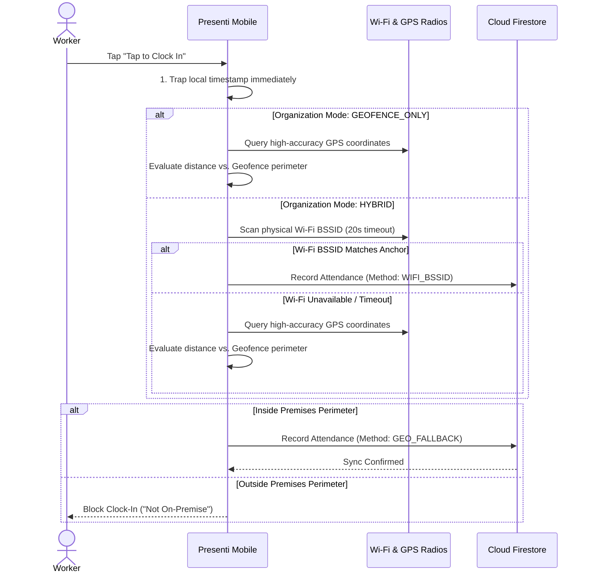

# Presenti — Mobile Workforce & Presence Verification App

[](https://expo.dev/)
[](https://reactnative.dev/)
[](https://www.typescriptlang.org/)
[](https://firebase.google.com/)
[](https://developers.google.com/identity)

**Presenti Mobile** is the client application for the Presenti workforce attendance and presence verification platform. Designed for modern workforces, institutions, and organizations, it guarantees verified physical presence using hardware radio scanning, satellite GPS geofencing, and single-device cryptographic locks—eliminating proxy attendance, location spoofing, and buddy punching.

---

## Core Capabilities & Features

### 1. Instant Clock-In Timestamp Trapping
- **Zero-Latency Timestamp Capture:** Captures the exact sub-second timestamp the millisecond the worker taps **"Tap to Clock In"**.
- **Tamper-Resistant Clock:** Trapped arrival timestamps are stored locally before background network verification starts. Workers are never penalized for slow cellular networks or brief connectivity drops.

### 2. Dual-Mode Physical Presence Engine
The mobile application dynamically reads the organization's calibrated architecture:
- **Mode A: Hybrid Verification (Office Router + GPS Geofence):**
  - **Tier 1 — Hardware Wi-Fi Anchor (BSSID):** Scans the device's physical Wi-Fi radio for the organization's calibrated router MAC address (`targetBssid`). This prevents clock-ins outside premises via fake SSIDs or mobile hotspot tethering.
  - **20-Second Hardware Scan Timeout:** If physical Wi-Fi scanning times out, the app automatically fails over to Tier 2 geofencing.
  - **Tier 2 — GPS Perimeter Geofencing:** Calculates distance from calibrated coordinates using high-accuracy native GPS (`expo-location`). Clock-in is approved only if within the calibrated perimeter (10m to 100m).
- **Mode B: Router-Free (Satellite GPS Geofence Only):**
  - Completely bypasses physical router scanning for field teams, pop-up events, and mobile workspaces.
  - Verifies presence directly against high-accuracy satellite GPS coordinates with sub-second response times.
- **Offline Attendance Trapping:** If the venue loses internet connectivity, punch records are cryptographically tagged, stored in local cache (`AsyncStorage`), and automatically pushed to Cloud Firestore once connectivity resumes.

### 3. Hardware Device Binding (Anti-Buddy Punching)
- **One Worker, One Device:** Upon onboarding, the worker's account is permanently bound to their smartphone's unique hardware identifier.
- **Account Sharing Prevention:** Signing in from another person's device is rejected, eliminating proxy clock-ins.

### 4. Administrator Premises Calibration Suite
- **Secret 5-Second Logo Gesture:** The calibration mode is completely invisible to regular workers. Administrators access it by pressing and holding the Presenti logo on the sign-in screen or header for 5 seconds.
- **QR Code Pairing Gateway:** Administrators scan a live session QR code displayed on the Admin Web Portal to pair their phone.
- **Instant Camera Dismissal:** The camera scanner unmounts the millisecond the QR payload is verified, revealing the interactive calibration screen.
- **Physical Spectrum Scanner:** Discovers nearby Wi-Fi access points, signal strength (RSSI), and exact router BSSID MAC addresses for binding.
- **Fast GPS Lock:** High-accuracy GPS sampling captures satellite coordinates for geofence anchoring.
- **Clean Disconnect Handling:** Tagged disconnect origins (`source: "MOBILE_APP"`) ensure exiting calibration from the phone never triggers false "session ended by web admin" toasts.

### 5. Streamlined Worker Onboarding & Google Sign-In
- **Native Google SSO:** Single sign-on powered by `@react-native-google-signin/google-signin` on Android/iOS and Firebase Auth.
- **Clean Root Navigation:** Dynamic full-screen initial boot flow ensuring zero split-screen or layout glitches.
- **Automated Organization Code Formatting:** Auto-inserts hyphens as workers type their organization code (`XX-XXX-XXX`, e.g., `TO-CRR-656`).
- **Dynamic Department Enrollment:** Dynamically loads department listings from the organization's cloud profile.

---

## System Architecture



---

## Tech Stack

| Component | Technology |
|---|---|
| **Framework** | React Native (Expo SDK 52) |
| **Routing** | Expo Router (File-based navigation) |
| **Language** | TypeScript 5.6 |
| **Authentication** | Google Sign-In Native SDK (`@react-native-google-signin/google-signin` 16.1.5) + Firebase Auth |
| **Database** | Firebase Firestore (Real-time snapshots & offline cache) |
| **Wi-Fi Hardware Scanner** | `react-native-wifi-reborn` / Native Network APIs |
| **Location & Geofencing** | `expo-location` (High accuracy native GPS) |
| **Camera & QR** | `expo-camera` (`CameraView`) |
| **Local Storage** | `@react-native-async-storage/async-storage` |

---

## Getting Started

### Prerequisites
- Node.js 18.x or 20.x
- Expo CLI (`npx expo`)
- EAS CLI (`npm install -g eas-cli`)
- Android Studio / Android Device (for native development build)

### Installation

1. Clone the repository:
   ```bash
   git clone https://github.com/kachiDeGreat/Presenti-mobile.git
   cd Presenti-mobile
   ```

2. Install dependencies:
   ```bash
   npm install
   ```

3. Configure Environment Variables:
   Create a `.env` file in the root directory:
   ```env
   EXPO_PUBLIC_FIREBASE_API_KEY=your_firebase_api_key
   EXPO_PUBLIC_FIREBASE_AUTH_DOMAIN=your_project.firebaseapp.com
   EXPO_PUBLIC_FIREBASE_PROJECT_ID=your_project_id
   EXPO_PUBLIC_FIREBASE_STORAGE_BUCKET=your_project.appspot.com
   EXPO_PUBLIC_FIREBASE_MESSAGING_SENDER_ID=your_sender_id
   EXPO_PUBLIC_FIREBASE_APP_ID=your_app_id
   EXPO_PUBLIC_GOOGLE_WEB_CLIENT_ID=your_google_web_client_id.apps.googleusercontent.com
   ```

4. Ensure `google-services.json` is present in the project root:
   - Required by EAS and Android build tools for native Firebase and Google Play Services.

5. Start the Development Server:
   ```bash
   npx expo start --dev-client
   ```

6. Building a Standalone Preview APK:
   To generate a shareable test APK without code signing requirements:
   ```bash
   eas build -p android --profile preview
   ```

---

## Git Branches

- `master`: Production development branch.
- `stable`: Verified, stable release checkpoint.

---

## Related Repositories

- **Admin Web Portal (React / Vite):** [kachiDeGreat/Presenti-web-admin](https://github.com/kachiDeGreat/Presenti-web-admin)
- **Live Admin Web Portal:** [https://presenti-admin-web.vercel.app](https://presenti-admin-web.vercel.app)

---

## License

Private & Proprietary — Developed for Presenti Workforce Systems.
