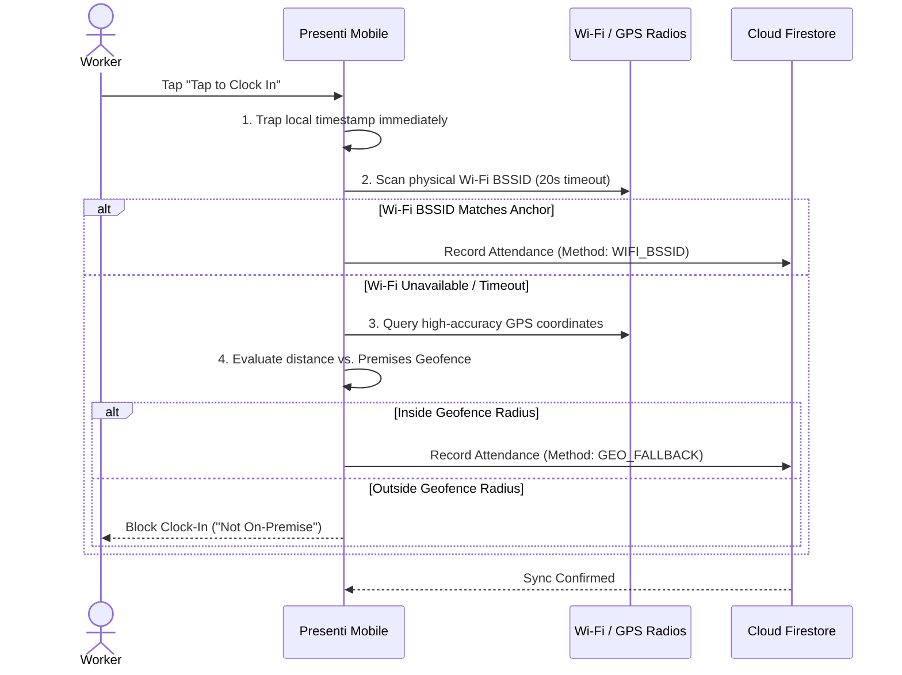

# Presenti — Mobile Workforce & Presence Verification App

[](https://expo.dev/)
[](https://reactnative.dev/)
[](https://www.typescriptlang.org/)
[](https://firebase.google.com/)
[](https://developers.google.com/identity)

**Presenti Mobile** is the client application of the Presenti attendance ecosystem. Designed for workforce teams, educational institutions, and organizations, it guarantees authentic physical presence using a combination of hardware radio analysis, GPS geofencing, and device biometric locks—effectively eliminating proxy attendance, mock locations, and buddy punching.

---

## Core Capabilities & Features

### 1. Instant Timestamp Trapping
- **Zero-Latency Arrival Time Capture:** Captures the exact sub-second timestamp the millisecond the worker presses **"Tap to Clock In"**.
- **Tamper-Resistant Clock:** Trapped timestamps are locked locally before background network verification starts, ensuring workers are never penalized for slow internet connections.

### 2. Dual-Tier Physical Presence Engine
- **Tier 1 — Hardware Wi-Fi Anchor (BSSID):** Scans the device's physical Wi-Fi radio for the organization's calibrated router MAC address (`targetBssid`). This prevents workers from clocking in outside premises by faking an SSID or using personal mobile hotspots.
- **20-Second Hardware Scan Timeout:** If physical Wi-Fi scanning takes longer than 20 seconds, the app automatically transitions seamlessly to Tier 2 geofencing.
- **Tier 2 — GPS Perimeter Geofencing:** Accurately calculates real-time distance from calibrated premises coordinates using high-accuracy native GPS (`expo-location`). Clock-in is only approved if the worker is physically within the calibrated perimeter (e.g., 10m to 100m).
- **Offline Punch Trapping:** If the venue loses internet connectivity, punch records are cryptographically tagged, stored in local cache (`AsyncStorage`), and automatically pushed to the cloud once network connectivity resumes.

### 3. Hardware Device Binding (Anti-Buddy Punching)
- **One Worker, One Device:** Upon onboarding, the worker's account is permanently bound to their smartphone's unique hardware identifier.
- **Account Sharing Prevention:** Signing into another person's device is immediately rejected, eliminating buddy punching and proxy clock-ins.

### 4. Admin Premises Calibration Suite
- **QR Code Pairing Gateway:** Organization administrators scan a live session QR code displayed on the Admin Web Portal to unlock the calibration suite on their phone.
- **Instant Camera Dismissal:** The camera feed unmounts the instant the QR payload is verified, immediately presenting an interactive calibration workspace.
- **Physical Wi-Fi Spectrum Scanner:** Discovers nearby access points, signal strengths (RSSI), and exact router BSSID MAC addresses for binding.
- **High-Speed GPS Lock:** Uses cached location services (`< 50ms`) with high-accuracy GPS refinement. Organization coordinates are only updated when explicitly requested by the admin.
- **Confirmation Pop-Up Modal:** Displays a comprehensive summary of the selected router BSSID, SSID hint, geofence radius, and latitude/longitude before synchronizing to the cloud.

### 5. Streamlined Worker Onboarding
- **Google SSO Integration:** Fast, secure single sign-on via `@react-native-google-signin/google-signin` on Android/iOS and Firebase Auth.
- **Automated Code Formatting:** Auto-inserts hyphens as the worker types their organization code (`XX-XXX-XXX`, e.g., `TO-CRR-656`).
- **Dynamic Department Enrollment:** Automatically pulls department listings from the organization's cloud profile.

---

## System Architecture



---

## Tech Stack

| Component | Technology |
|---|---|
| **Framework** | React Native (Expo SDK 52) |
| **Routing** | Expo Router (File-based navigation) |
| **Language** | TypeScript |
| **Authentication** | Google Sign-In Native SDK + Firebase Auth |
| **Database** | Firebase Firestore (Real-time snapshots & offline cache) |
| **Wi-Fi Hardware Scanner** | `react-native-wifi-reborn` / Native Network APIs |
| **Location & Geofencing** | `expo-location` (High accuracy + Geolib distance calculations) |
| **Camera & QR** | `expo-camera` (`CameraView`) |
| **Local Storage** | `@react-native-async-storage/async-storage` |

---

## Getting Started

### Prerequisites
- Node.js 18.x or 20.x
- Expo CLI (`npm install -g expo-cli` or via `npx expo`)
- Android Studio (for Android Emulator) or physical Android/iOS device
- Expo Development Build (`expo-dev-client`) required for native Wi-Fi & Google Sign-In modules

### Installation

1. Clone the repository:
   ```bash
   git clone https://github.com/kachiDeGreat/Presenti-mobile.git
   cd Presenti-mobile
   ```

2. Install dependencies:
   ```bash
   npm install
   ```

3. Environment Variables:
   Create a `.env` file in the root directory:
   ```env
   EXPO_PUBLIC_FIREBASE_API_KEY=your_firebase_api_key
   EXPO_PUBLIC_FIREBASE_AUTH_DOMAIN=your_project.firebaseapp.com
   EXPO_PUBLIC_FIREBASE_PROJECT_ID=your_project_id
   EXPO_PUBLIC_FIREBASE_STORAGE_BUCKET=your_project.appspot.com
   EXPO_PUBLIC_FIREBASE_MESSAGING_SENDER_ID=your_sender_id
   EXPO_PUBLIC_FIREBASE_APP_ID=your_app_id
   EXPO_PUBLIC_GOOGLE_WEB_CLIENT_ID=your_google_web_client_id.apps.googleusercontent.com
   ```

4. Start Development Server:
   ```bash
   npx expo start --dev-client
   ```

5. Building a Native APK / Development Client:
   ```bash
   npx eas-cli build --profile development --platform android
   ```

---

## Related Repositories

- **Admin Web Portal (React / Vite):** [kachiDeGreat/Presenti-web-admin](https://github.com/kachiDeGreat/Presenti-web-admin)
- **Live Admin Portal:** [https://presenti-admin-web.vercel.app](https://presenti-admin-web.vercel.app)

---

## License

Private & Proprietary — Developed for Presenti Workforce Systems.
